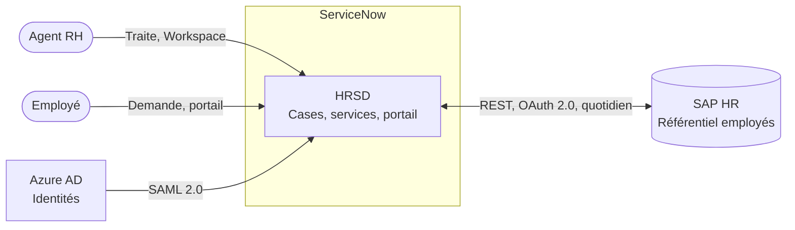
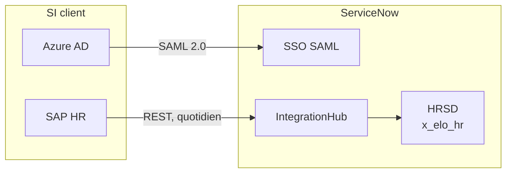
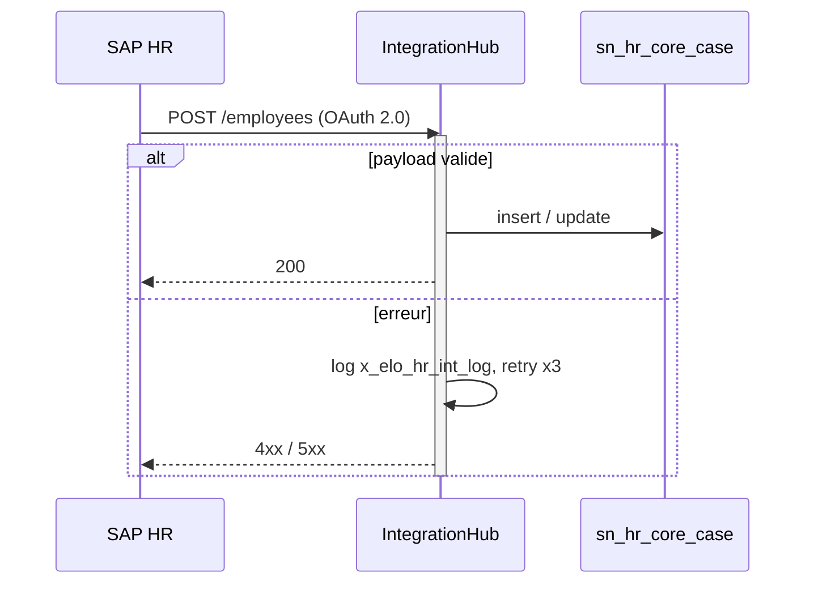
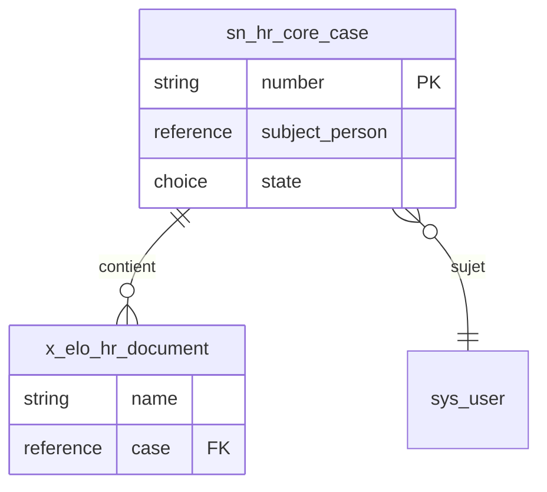

# Mermaid for DAT figures

The build renders every block with one ELO theme (blues, pale fills, navy lines, Century
Gothic). Diagrams carry no `style`, `classDef`, `%%{init}` or colour of their own: the look is
the template's, the diagram is the content. The four skeletons below render as-is; start from
them.

## Rules that keep a figure readable in a .docx

- One view per figure, one figure per page: at most 12 nodes or 8 lifelines. Split, or move
  the detail to a table.
- Direction: `LR` for flows between systems, `TB` for layered or hierarchical views.
- Every edge has a label: protocol, data, frequency or trigger (`"REST, quotidien"`). An
  unlabelled arrow is a question the board will ask.
- Zones as `subgraph`: SI client, ServiceNow, external. Same zone names in every figure.
- Same node name for the same thing in every figure, matching the text and the tables:
  `SAP HR` everywhere, not `SAP`, `SAP RH`, `SAP HCM`. ServiceNow artifacts carry their
  technical name on a second line (`HRSD x_elo_hr`).
- Labels in the document language, ServiceNow terms in English, no emoji, no superlatives.
  Quote any label with punctuation: `A["Flux (quotidien)"]`.
- Short ids without accents or spaces (`sap`, `hrsd`); the label carries the display name.
- Sequence diagrams show the error path (`alt` … `else`), the retry and the log table, not
  only the happy path.
- No `C4Context` / `C4Container`: Mermaid's C4 engine has no real layout and the edges cross
  the boxes. The context view is a `flowchart` with shapes: actors `([Agent RH])`, systems
  `[Nom]`, data stores `[("Nom")]`, the platform inside a `subgraph`.
- After the block, one paragraph explains the figure: what is in it, what is not, which
  hypothesis it rests on.

## Context view

## Logical or deployment view

## Integration

## Data model

